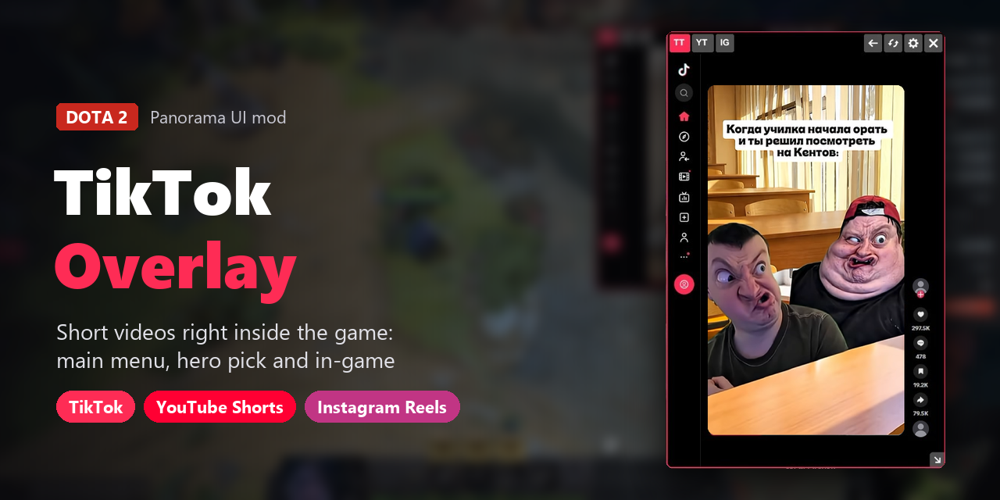
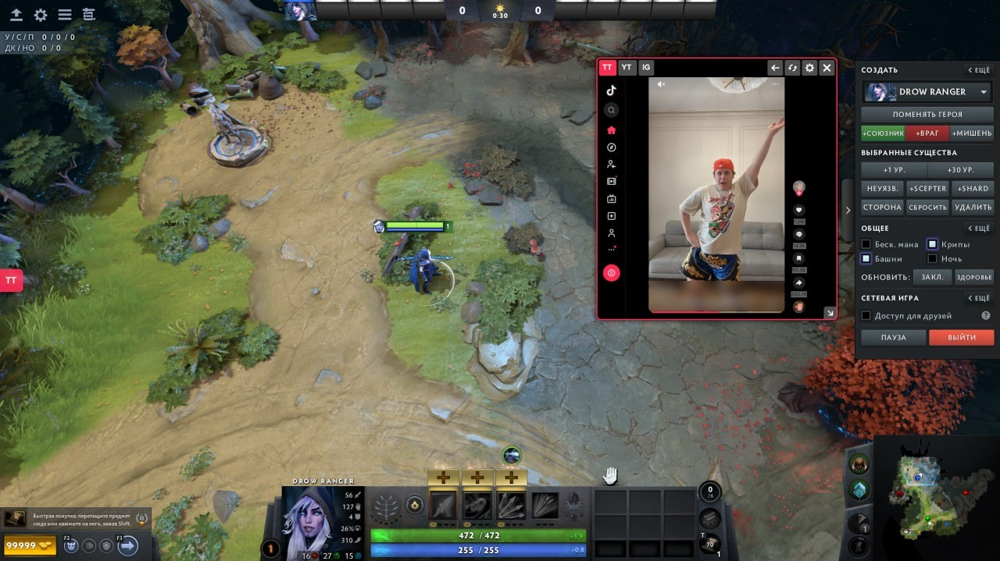
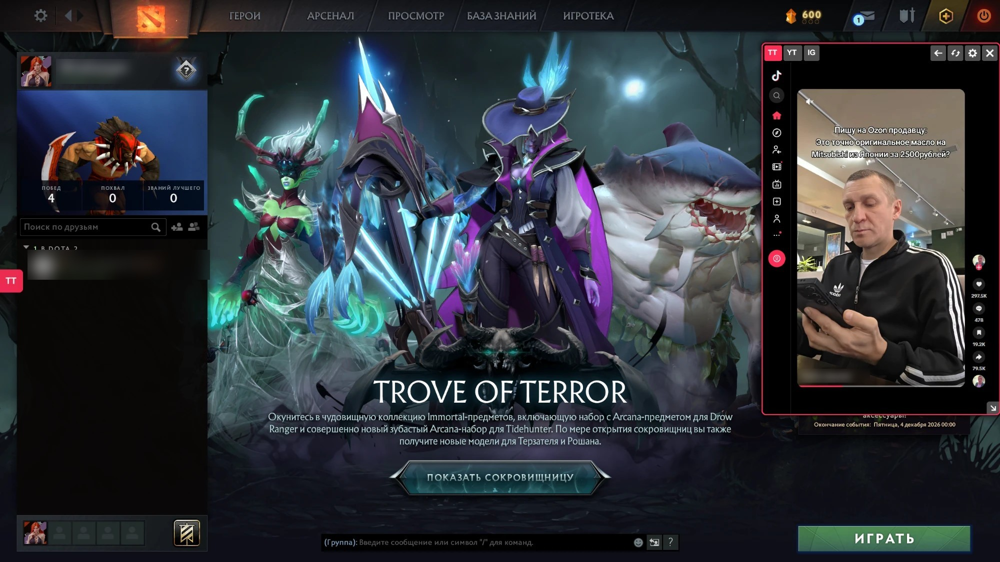

# Dota 2 TikTok overlay

Окно с **TikTok, YouTube Shorts и Instagram Reels** прямо в интерфейсе Dota 2: в главном меню, на выборе героя и в матче.

> **English:** a Panorama UI mod that adds a draggable, resizable browser window with TikTok / YouTube Shorts /
> Instagram Reels to the Dota 2 main menu, hero pick and in-game HUD. Run `python build.py` (game closed),
> re-run after every Dota update. Details below are in Russian.





## Возможности

- Окно открывается кнопкой у левого края экрана или клавишей **F8**.
- Вкладки **TT / YT / IG**. Повторный клик по активной вкладке возвращает на главную сервиса.
- Окно перетаскивается за шапку, размер меняется за уголок справа снизу.
- Кнопки «назад» и «обновить».
- Кнопки «предыдущее / следующее видео» у правого края окна (TikTok и YouTube Shorts): листают ровно на одно видео.
- Когда окно закрыто, звук останавливается. В настройках можно включить «продолжать играть».
- Окно следует за экраном игры: если открыть его в меню и зайти в матч, оно закроется на время
  загрузки и само откроется в матче на том же видео. Так же при выходе из матча.
- Вход в аккаунты общий для всех окон: браузер встроен в клиент Steam.

## Установка

### Проще всего: exe

1. Скачай `dota2-tiktok-overlay.exe` со страницы [Releases](../../releases/latest).
2. **Закрой Доту** и запусти exe двойным кликом.

Exe и сами релизы делает [GitHub Actions](../../actions/workflows/release.yml) прямо из исходников этого
репозитория. SHA-256 файла GitHub показывает рядом с ним на странице релиза.

Windows SmartScreen или антивирус могут ругаться на неподписанный exe, собранный PyInstaller.
Если не доверяешь, используй вариант с Python ниже: exe собирается из того же `build.py`.

### Через Python

Нужен [Python](https://www.python.org/downloads/) 3.9 или новее.

1. Скачай репозиторий: зелёная кнопка **Code → Download ZIP** и распакуй, или `git clone`.
2. **Закрой Доту** и запусти в папке мода:

   ```bash
   python build.py
   ```

### Куда ставится мод

И exe, и `build.py` сами находят Доту и ставят мод:

- если стоит [Dota 2 Mod Manager](https://dota2modmanager.com) — в его папку, рядом с остальными модами;
- иначе — в `game/dota_tempcontent`. Тогда в Steam добавь Доте параметр запуска
  `-language tempcontent` (Библиотека → Dota 2 → Свойства → Параметры запуска).
  Это распространённый способ подключения модов, но я проверял мод только с Mod Manager.

Если игра не нашлась сама, укажи путь (для exe — то же самое, только `dota2-tiktok-overlay.exe` вместо `python build.py`):

```bash
python build.py --game "D:\SteamLibrary\steamapps\common\dota 2 beta\game"
```

> **После каждого обновления Доты запускай exe или `python build.py` снова.** Мод встраивается в файлы
> интерфейса игры, и после патча старая версия может сломать меню или HUD.

Удалить мод:

```bash
python build.py --uninstall
```

## Настройка

Горячую клавишу можно сменить в настройках окна (шестерёнка), но только до перезапуска Доты.
Постоянно — при сборке:

```bash
python build.py --key f9
```

Имена клавиш: `f1`…`f12`, `insert`, `home`, `end`, `pageup`, `pagedown`, `scrolllock`, `break` (Pause),
`backquote`, буквы и цифры (`a`, `5`), `pad_0`…`pad_9`.

Список сервисов, их адреса и размер окна по умолчанию задаются в [config.json](config.json).
Для exe положи свой `config.json` рядом с ним: он заменит встроенный.

## Ограничения

- Браузер в Доте не даёт выполнять свой код на странице, поэтому **автолистания нет**, а «назад»
  работает по своей истории адресов.
- Колесо мыши прокручивает ленту, но не доводит её до следующего видео (так работает браузер Steam
  внутри игры). Поэтому листать удобнее кнопками у правого края окна.
- Стрелки **↓ / ↑** листают видео, пока курсор над окном. Убрал курсор с окна — клавиши снова
  работают в игре.
- **Набор текста** (логин, коды, поиск) работает только в главном меню Доты, в матче буквы и цифры
  в окне не печатаются. Если нужно ввести что-то во время матча:
  - нажми кнопку **«Меню»** слева вверху (значок со стрелкой вверх): поверх игры откроется главное меню,
    и окно мода откроется там на том же видео или той же странице. Введи что нужно и вернись в матч,
    окно вернётся вместе с тобой;
  - или открой консоль Доты, если она у тебя включена: пока консоль открыта, печатать в окне тоже можно.
- **Вход через Google, Facebook и Apple** прямо в окне не работает: им нужны всплывающие окна.
  Войди в **оверлее Steam** (по умолчанию Shift+Tab): открой там сайт, войди, закрой оверлей
  и нажми «обновить» в окне мода. Вход сохранится и в окне, это тот же браузер Steam.
  Вход по QR-коду, номеру или логину работает и прямо в окне.
- **Instagram Reels:** в узком окне Instagram показывает ленту видео друг под другом и не создаёт
  кнопок «следующее видео». Остаётся колесо мыши или окно пошире.

## Риски

Мод изменяет файлы интерфейса игры. Это не чит и на геймплей не влияет, но формально нарушает правила
Steam и Dota 2. Используешь на свой страх и риск, в рейтинговых играх лучше не надо.

## Как это устроено

| Файл игры | Где работает |
|---|---|
| `panorama/scripts/play.vts_c` | главное меню |
| `panorama/scripts/hud/hud_reborn.vjs_c` | HUD матча, включая выбор героя |
| `panorama/browser/webkit.css` | стили внутри веб-страниц окна |

- В скомпилированных скриптах `.vjs_c` / `.vts_c` блок DATA — обычный JavaScript. `build.py` берёт эти два
  файла из `pak01_dir.vpk` твоей игры, дописывает в конец [overlay.js](overlay.js) с настройками
  из `config.json`, пересобирает ресурсы и пакует их в `pak88_dir.vpk`. Workshop Tools не нужны,
  файлы Valve в репозитории не хранятся.
- Окно — панель `HTML` (браузер клиента Steam). Из JS у неё есть только `SetURL`, ссылки `javascript:`
  она заменяет пустой страницей. Поэтому пауза = выгрузка страницы, а возврат = загрузка последнего адреса.
- `webkit.css` игра передаёт браузеру как стили для всех страниц. `build.py` дописывает к нему
  [page.css](page.css), который показывает спрятанные в узком окне кнопки «вверх/вниз» сайтов.
- Перетаскивание и ресайз: опрос `GameUI.IsMouseDown` / `GameUI.GetCursorPosition`.
- Меню и HUD — разные окна интерфейса. Общее состояние хранится в `GameUI.CustomUIConfig()`,
  смена экрана отслеживается по событию `DOTAGameUIStateChanged`.

### Сборка exe

Релизы делает workflow [.github/workflows/release.yml](.github/workflows/release.yml): **Actions → Build exe →
Run workflow**, в поле version указать новый тег (например `v1.2.0`). Он соберёт exe, создаст тег и релиз
на текущем коммите и приложит exe. С пустым version workflow только собирает exe в артефакт.
Собрать exe локально:

```bash
python -m PyInstaller --onefile --console --name dota2-tiktok-overlay --add-data "overlay.js;." --add-data "config.json;." --add-data "page.css;." build.py
```

### Отладка

Логи мода пишутся в консоль с префиксом `[TikTokMod]`. Удобнее всего смотреть их в
`game/bin/win64/vconsole2.exe`, запустив Доту с параметром `-vconsole`.

## Лицензия

[MIT](LICENSE) — только на код этого репозитория.
